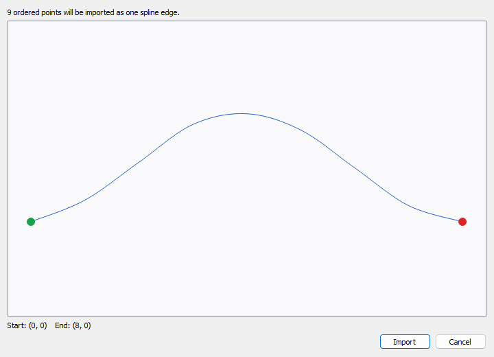
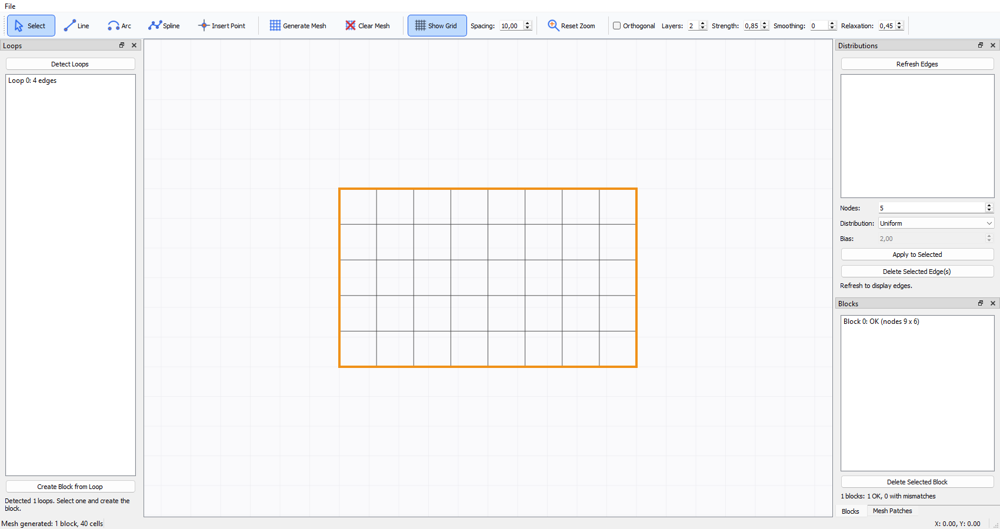
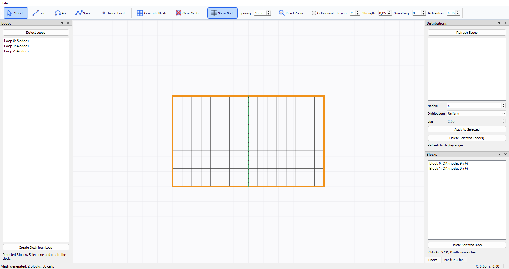
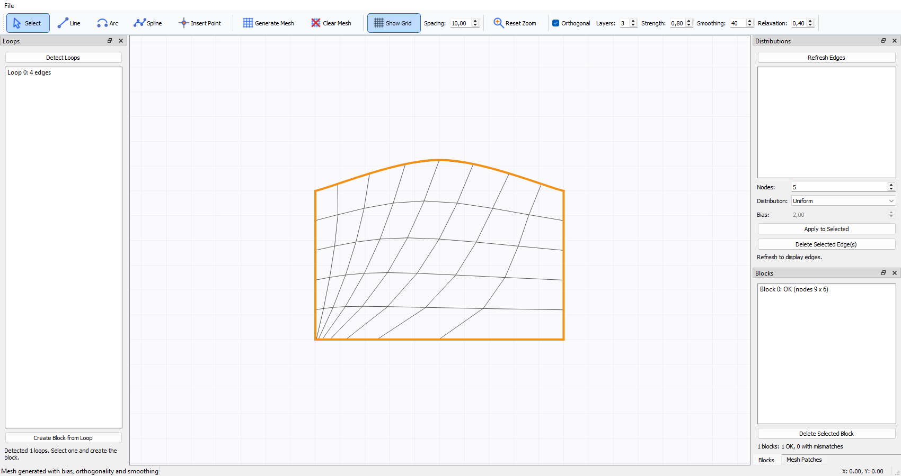
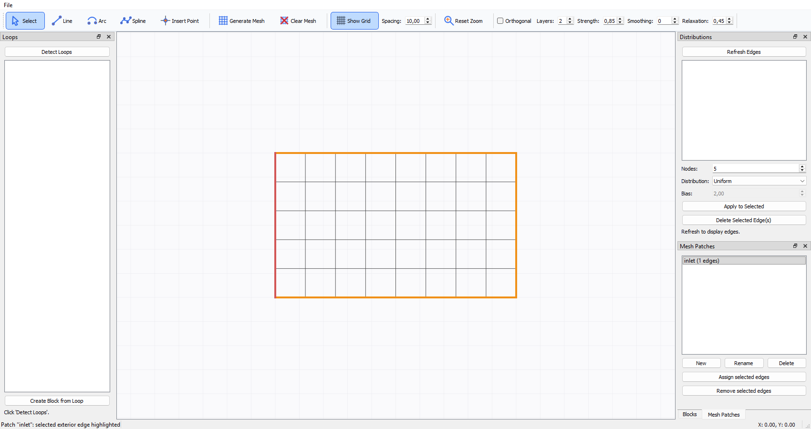

# MeshCAD User Manual

## Starting the Application

From the project root, run:

```bash
python -m meshcad
```

## Interface Overview

The main window contains:

- **File menu:** New, Open, Import Point Sequence, Save, Save As, Export Mesh
  (VTK), Export Mesh (JSON), and Exit.
- **Toolbar:** Select, Line, Arc, Spline, Insert Point, Generate Mesh, Clear Mesh, Show Grid, Reset Zoom, and live mesh-improvement controls.
- **Central canvas:** drawing, selection, geometry editing, zoom, pan, and mesh visualization.
- **Loops panel:** closed-loop detection and block creation.
- **Distributions panel:** edge selection, node counts, and distribution settings.
- **Blocks panel:** block dimensions and compatibility status.
- **Mesh Patches panel:** groups exterior block edges into named boundary patches.
- **Status bar:** operation messages and current cursor coordinates.

Hold the pointer over a toolbar icon or parameter control to display its tooltip.
The active drawing tool (Select, Line, Arc, or Spline) stays highlighted in the
toolbar. Vertex and spline/arc grip markers keep a constant on-screen size as
you zoom.

## Canvas Navigation

- Rotate the **mouse wheel** to zoom around the pointer.
- Hold the **middle mouse button** and drag to pan.
- Click **Reset Zoom** to fit the complete model in the viewport.
- Press **Esc** to cancel the active drawing tool.
- Read the current scene coordinates in the status bar.

## Typical Workflow

### 1. Draw Geometry

Choose one of the CAD tools:

- **Line:** click the start point and the end point.
- **Arc:** click the center, the start point, and the end point. The arc is traversed counterclockwise.
- **Spline:** add control points with left-click and finish with right-click.
- **Insert Point:** enter exact X and Y coordinates for an isolated vertex.

A dashed preview shows the candidate geometry while the pointer moves. Existing vertices appear as light red circles. New points snap to nearby vertices so that contours can be closed accurately.
The coordinate readout in the status bar helps place geometry against the
visible grid. The selected drawing tool remains highlighted until another tool
is selected; press **Esc** to cancel it and return to **Select**.

### Import an Ordered Point Sequence

Choose **File > Import Point Sequence** and select a CSV or TXT file containing
two comma-separated coordinates per row:

```text
X,Y
0.0,0.0
1.0,0.5
2.0,0.0
```

The optional header is `X,Y` (case-insensitive). Blank rows are ignored, but
each data row must contain exactly two finite numbers. The points are used in
file order; they are never sorted. At least two points are required, and
consecutive duplicates are rejected.

MeshCAD previews the interpolated curve, marks its start in green and end in
red, and reports the number of input points. Confirm with **Import** to add the
sequence as one spline edge. The first and last points are its topological
endpoints; intermediate points are editable spline grips. If an endpoint lies
within the topology tolerance of an existing vertex, it is connected to that
vertex. No closure, smoothing, or point reduction is applied automatically.
The imported curve can participate in a block loop when its endpoints connect
to other geometry.



### 2. Edit Geometry

Switch to **Select** before editing.

- Drag a red vertex to move every connected edge.
- Drag a blue grip to move an arc center or an internal spline control point.
- Double-click a vertex or grip to enter exact coordinates.
- When an arc center is edited, its endpoints remain fixed and the center is constrained to the chord perpendicular bisector.
- Existing block meshes are regenerated automatically after relevant geometry changes.

### 3. Detect a Closed Loop

In the **Loops** panel, click **Detect Loops**. Closed contours are listed. Selecting a loop highlights it in green on the canvas.

If no loop is detected:

1. zoom into every connection;
2. check for gaps or duplicate endpoints;
3. use snapping or double-click coordinate editing to make endpoints coincide;
4. run **Detect Loops** again.

### 4. Create a Structured Block

Select a loop and click **Create Block from Loop**. Click four distinct loop vertices. These vertices define the four logical corners. The portions of the loop between consecutive corners become the four block sides.

A block side may contain one or several CAD edges.

### 5. Configure Edge Distributions

In the **Distributions** panel:

1. click **Refresh Edges** if necessary;
2. select one or more edges;
3. set the total number of nodes, including both endpoints;
4. choose **Uniform** or **Biased** distribution;
5. set **Bias** when a biased distribution is selected;
6. click **Apply to Selected**.

You can also select an edge by clicking it on the canvas. Hold **Ctrl** while
clicking to add or remove individual edges from the selection. A regular click
selects only that edge, and clicking empty canvas clears the selection.

A shared edge has one distribution specification, so adjacent blocks automatically use the same interface nodes.

#### Distribution Types

- **Uniform:** equal spacing in the edge parameter.
- **Biased, Bias = 1:** equivalent to uniform spacing.
- **Biased, Bias > 1:** smaller intervals near the edge start and progressively larger intervals toward the end.

### 6. Validate Blocks

The **Blocks** panel reports whether opposite sides have compatible node totals.

Typical states are:

- `OK (nodes N x M)`
- `MISMATCH sides 0/2: A vs B`
- `MISMATCH sides 1/3: A vs B`

For a valid structured block:

- side 0 must have the same total number of nodes as side 2;
- side 1 must have the same total number of nodes as side 3.

### 7. Generate the Mesh

Click **Generate Mesh**. The structured grid appears over each valid block, and the status bar reports the number of blocks and cells.

Click **Clear Mesh** to hide generated meshes without deleting geometry, blocks, or distribution settings.

## Mesh Improvement Controls

The toolbar includes live controls for mesh improvement.

### Orthogonality

Enable **Orthogonal** to push the first interior layers toward the local boundary-normal direction.

- **Layers:** number of interior layers affected.
- **Strength:** correction fraction from `0` to `1`.

Useful initial values are 2 to 4 layers and a strength from 0.70 to 0.90.

### Elliptic Smoothing

- **Smoothing:** number of interior smoothing iterations.
- **Relaxation:** update fraction per iteration.

Useful initial values are 20 to 60 iterations and a relaxation factor from 0.30 to 0.50. Boundary nodes remain fixed.

## Complete Tutorials

The tutorials below start from a blank project and use the controls in the
current application. Drawing clicks are approximate; use the status-bar
coordinates and grid as a guide. The important requirements are shared snapped
vertices, closed loops, and matching node counts on opposite sides.

### Tutorial 1: Rectangular Block from Drawing to Mesh

**Goal:** Build one rectangular block with 9 nodes horizontally and 6
vertically (40 cells).



1. Start MeshCAD and choose **File > New** if a project is already open.
2. Leave **Show Grid** enabled. Adjust **Spacing** if a finer or coarser
   drawing reference is useful.
3. Click **Line**. Draw the four rectangle sides by clicking the lower-left,
   lower-right, upper-right, upper-left, and lower-left points in sequence.
   Snap the last click to the first vertex so the contour closes. The Line
   button remains highlighted while drawing.
4. Click **Select** to leave line-drawing mode. In the **Loops** panel, click
   **Detect Loops**. Select the detected four-edge loop; it is highlighted
   green on the canvas.
5. Click **Create Block from Loop**, then click the four rectangle vertices.
   They can be selected in any order, but all four must be distinct. The
   **Blocks** panel should show one block.
6. In **Distributions**, click **Refresh Edges** if needed. Select the lower
   and upper edges (use Ctrl-click for multiple edges). Set **Nodes** to `9`,
   **Distribution** to **Uniform**, then click **Apply to Selected**.
7. Select the left and right edges. Set **Nodes** to `6`, keep **Uniform**, and
   click **Apply to Selected**.
8. Confirm the block status is `OK (nodes 9 x 6)`. If it reports a mismatch,
   inspect the listed opposite sides and apply matching totals.
9. Click **Generate Mesh**. The canvas should show a structured grid with
   `(9 - 1) x (6 - 1) = 40` cells.
10. Choose **File > Save As** and save the project as a `.json` file.

### Tutorial 2: Two Conformal Blocks and a Shared Interface

**Goal:** Create two side-by-side rectangular blocks that share one edge and
have matching interface nodes.



1. Start a blank project and select **Line**.
2. Draw the lower outer boundary as two segments: lower-left to the center
   point, then center to lower-right. The center must be a real vertex where
   the interface meets the boundary.
3. Draw the right outer vertical side, the upper boundary as two segments
   (upper-right to upper-center, then upper-center to upper-left), and the left
   outer vertical side. Snap endpoints to existing vertices as you close the
   outline.
4. Draw the internal vertical interface from the lower-center vertex to the
   upper-center vertex, snapping to both. The result is a pair of adjacent
   closed loops. Do not draw a second overlapping copy of this interface.
5. Select **Select**, then click **Detect Loops**. Select each loop in turn to
   confirm that it highlights one rectangle.
6. Select the first loop and click **Create Block from Loop**. Click its four
   corner vertices. Repeat for the second loop.
7. In **Distributions**, set all horizontal edges to `9` uniform nodes and all
   vertical edges—including the shared interface—to `6` uniform nodes. The
   shared edge has one specification, used by both blocks.
8. Check the **Blocks** panel. Both blocks should report `OK (nodes 9 x 6)`.
   Resolve any mismatch before generating.
9. Click **Generate Mesh**. Verify that both grids meet continuously at the
   shared edge and have the same number of interface nodes.
10. Select **Select** and drag an exterior vertex to adjust the geometry.
    Generated meshes update when the geometry changes; regenerate if needed
    after changing mesh settings.
11. Save the project with **File > Save As**.

### Tutorial 3: Biasing a Boundary and Improving the Mesh

**Goal:** Compare a uniform mesh against a graded mesh with boundary
orthogonalization and smoothing.



1. Open the project from Tutorial 1 or 2, or create a block and generate its
   uniform baseline mesh.
2. In **Distributions**, select one exterior edge. The selected edge is
   highlighted on the canvas. Set **Distribution** to **Biased**, set **Bias**
   to `2.0`, and click **Apply to Selected**.
3. The bias direction follows the edge's start-to-end direction: a bias
   greater than `1` concentrates nodes near the start. The direction in which
   an edge was drawn therefore determines which endpoint receives finer
   spacing.
4. Keep opposite sides' node totals compatible. Generate the mesh and compare
   cell spacing with the uniform baseline.
5. Enable **Orthogonal**. Set **Layers** to `3` and **Strength** to `0.80`.
   Mesh improvement controls update the generated mesh live when blocks
   exist.
6. Set **Smoothing** to `40` iterations and **Relaxation** to `0.40`. Observe
   how interior lines change while boundary nodes remain fixed.
7. Compare with orthogonality disabled and smoothing set to `0`. Change one
   setting at a time so its effect is clear.
8. Inspect for crossed/inverted cells, abrupt size jumps, irregular interior
   lines, poor angles near boundaries, and discontinuities across block
   interfaces. Reduce bias, strength, iterations, or relaxation if the grid
   becomes distorted.
9. Save the project after choosing acceptable settings.

### Tutorial 4: Boundary Patches and Mesh Export

**Goal:** Assign exterior edges to a named boundary, save the project, and
export the mesh for visualization or CFD.



1. Open a project with at least one valid block, configure compatible edge
   distributions, and click **Generate Mesh**.
2. In **Mesh Patches**, click **New**, enter a name such as `inlet`, and
   confirm. Create additional patches for other boundary groups as required.
3. Select the desired patch. Its assigned edges are automatically selected
   and highlighted in the model. Selecting another patch replaces the
   selection; selecting an empty patch clears it.
4. In **Distributions**, select one or more exterior edges. Use Ctrl-click in
   the list or Ctrl-click edges on the canvas to add/remove edges from the
   selection.
5. Return to **Mesh Patches** and click **Assign selected edges**. Only
   exterior block edges are accepted. Shared edges between blocks are
   internal interfaces and cannot be assigned.
6. Repeat for other patches. An edge can belong to only one patch and cannot
   be assigned twice. A conflicting assignment is rejected; remove an edge
   from its current patch before assigning it elsewhere.
7. Choose **File > Save** to preserve the geometry, mesh settings, blocks, and
   patches in the project JSON.
8. For visualization, click **File > Export Mesh (VTK)** and save the `.pvd`
   file. Open it in ParaView. Keep the `.pvd` file together with the generated
   `<name>_blocks` folder and its `.vts` files.
9. For a CFD boundary mesh, click **File > Export Mesh (JSON)** and save a
   `.json` file. The export contains named boundary patches; shared block
   interfaces are represented as internal faces with owner and neighbour,
   not as boundary patches.
10. If an export is unavailable, confirm that a valid block and generated
    mesh exist, correct all block mismatches, and try again.

## Saving Projects

Use **File > Save** or **File > Save As**. The JSON project stores topology, geometry, edge distributions, blocks, and mesh-improvement parameters.

Use incremental project names before large geometry changes.

## Exporting VTK

1. Generate the mesh.
2. Choose **File > Export Mesh (VTK)**.
3. Select a `.pvd` filename.
4. MeshCAD creates the PVD file and a `<name>_blocks` folder containing one `.vts` file per block.
5. Open the `.pvd` file in ParaView to load all blocks together.

Keep the PVD file and its `_blocks` folder together because the collection uses relative paths.

## Mesh Patches and Block Interfaces

Only exterior block edges can be assigned to mesh patches. An edge shared by
two blocks is an internal interface and cannot belong to a patch.

Selecting a mesh patch highlights its edges in the model. An edge can belong
to only one patch and cannot be repeated within a patch; conflicting
assignments are rejected.

The CFD JSON export keeps shared-interface faces as internal faces with an
owner and neighbour; they are not assigned to boundary patches. VTK export
writes one structured grid per block, so the shared interface remains part of
each block grid rather than being exported as a boundary patch.

## Troubleshooting

### No loop is detected

The contour is open or two endpoints do not coincide. Inspect connections and edit the affected coordinates.

### A block reports MISMATCH

Opposite sides have different total node counts. Apply compatible distribution settings to the relevant edges.

### An edge cannot be deleted

The edge belongs to a block. Delete the associated block first.

### No mesh appears

Check that at least one valid block exists and that the Blocks panel reports compatible opposite sides.

### Geometry is outside the visible area

Click **Reset Zoom**.

### The arc center is not exactly at the requested point

A circular arc with fixed endpoints requires the center to remain on the chord perpendicular bisector. MeshCAD projects the requested center onto that line.

### The mesh is strongly distorted

Reduce bias, orthogonality strength, smoothing iterations, or relaxation. Increase parameters gradually and inspect each result.

### VTK export is unavailable

Generate the mesh before exporting.

## Mouse and Keyboard Reference

- **Left-click:** place points, select an item, or begin dragging.
- **Double left-click:** edit vertex or grip coordinates.
- **Right-click:** finish a spline.
- **Middle-button drag:** pan the view.
- **Mouse wheel:** zoom around the pointer.
- **Esc:** cancel the active tool.
- **File > Import Point Sequence:** preview and import an ordered CSV/TXT curve.

## Final Checklist

Before exporting a finished project, verify that:

- all intended contours are closed;
- every block reports `OK`;
- shared interfaces are conformal;
- no cells are crossed or inverted;
- grading transitions are acceptable;
- the project has been saved;
- the PVD/VTS export opens correctly.
